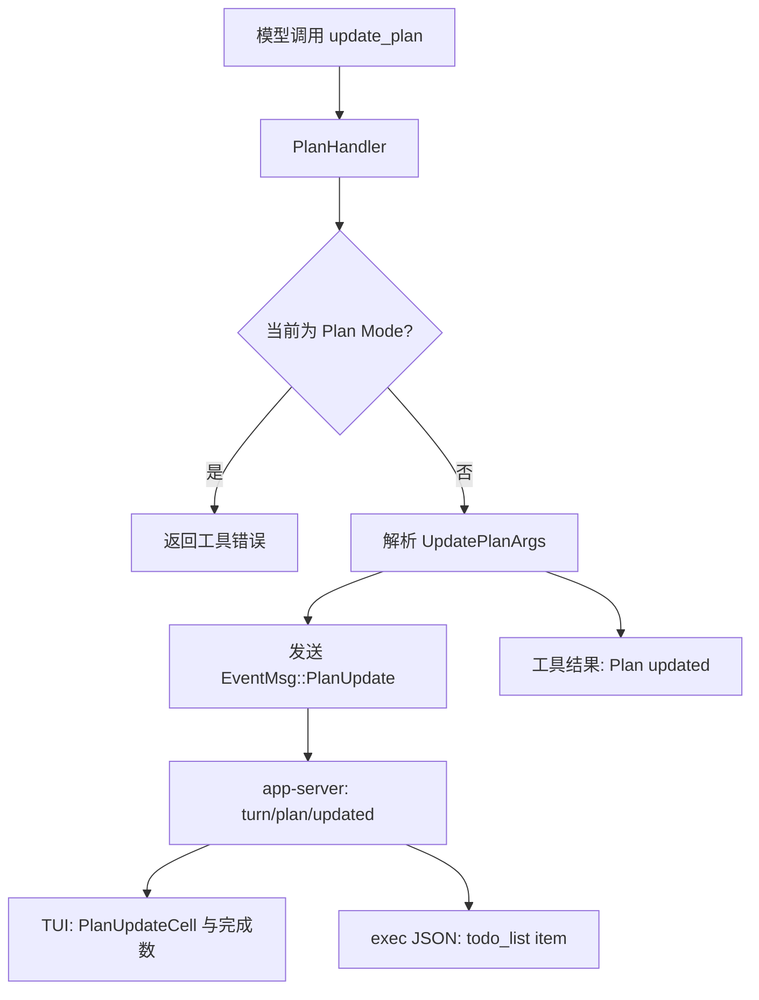
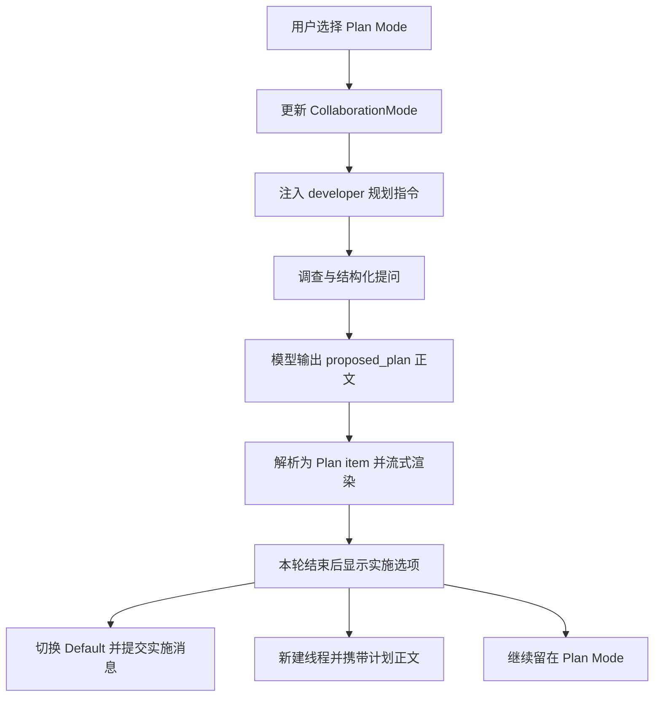

# Codex CLI todo list and Plan Mode implementation

## Scope and source version

调研日期为 2026-09-29。本机 `codex --version` 返回 `codex-cli 0.157.1`，因此以官方 `rust-v0.157.1` 为研究基线，没有把 `main` 当作这个版本的实现。

通过 `git ls-remote` 核验，annotated tag `ac0e23e5232692b95268583c8278c50b8c436d2b` 指向 commit `36650394c5b38c2990ccf2a3457165ca3e9d9726`。下文源码链接全部固定到这个 commit。本次阅读源码和上游测试，没有编译上游、启动模型会话或实测恢复流程。

先查询了 OpenAI 官方文档和 Context7。官方文档解释 `/plan` 的使用，但实现细节需要源码；Context7 当时列出的版本最高为 `rust-v0.155.1`，其内容仅用于定位，再用 `0.157.1` 源码核验。[官方 `/plan` 文档](https://developers.openai.com/codex/cli/slash-commands#switch-to-plan-mode-with-plan)、[固定源码](https://github.com/openai/codex/tree/36650394c5b38c2990ccf2a3457165ca3e9d9726)

## Main findings

Codex 将执行中的进度清单和规划会话分成两个机制。`update_plan` 提交一份结构化清单，前端据此显示进度；Plan Mode 切换会话设置、注入规划指令，并把模型输出的计划正文渲染成专门的消息。两者没有自动转换关系，Plan Mode 的 handler 还会明确拒绝 `update_plan`。[模式说明](https://github.com/openai/codex/blob/36650394c5b38c2990ccf2a3457165ca3e9d9726/codex-rs/collaboration-mode-templates/templates/plan.md#L11-L19)、[运行时拒绝](https://github.com/openai/codex/blob/36650394c5b38c2990ccf2a3457165ca3e9d9726/codex-rs/core/src/tools/handlers/plan.rs#L87-L99)

| 维度 | Todo list | Plan Mode |
| --- | --- | --- |
| 入口 | 模型调用 `update_plan` | 用户 `/plan` 或模式切换 |
| 核心数据 | `explanation` 和 `plan[{step,status}]` | `CollaborationMode` 和计划正文 |
| 状态含义 | 每一步的完成进度 | 当前会话是 `Default` 还是 `Plan` |
| 输出路径 | `PlanUpdate` → `turn/plan/updated` | `<proposed_plan>` → `TurnItem::Plan` 与 `item/plan/delta` |
| 执行衔接 | 清单本身不调度任务 | 用户确认后切换 Default，并提交实施消息 |

表中入口、数据、事件和实施衔接分别见下文源码证据。

## Todo list

### Registration and schema

这个版本只有配置 `tools.update_plan.enabled = true` 才注册 `PlanHandler`，未配置时默认关闭。这是 `0.157.1` 的源码默认值，不能根据旧版体验推断所有安装环境都默认启用。[配置解析](https://github.com/openai/codex/blob/36650394c5b38c2990ccf2a3457165ca3e9d9726/codex-rs/core/src/config/mod.rs#L2689-L2695)、[工具注册](https://github.com/openai/codex/blob/36650394c5b38c2990ccf2a3457165ca3e9d9726/codex-rs/core/src/tools/spec_plan.rs#L1098-L1106)

调用参数可以写成下面这样，文字为说明性示例。

```json
{
  "explanation": "已定位入口，开始实现",
  "plan": [
    { "step": "定位入口", "status": "completed" },
    { "step": "实现修改", "status": "in_progress" },
    { "step": "运行检查", "status": "pending" }
  ]
}
```

`explanation` 可选；`plan` 必填。每项只有 `step` 和 `status`，状态限定为 `pending`、`in_progress`、`completed`。没有步骤 ID、依赖、负责人、优先级或独立的新增、删除、更新接口。每次调用携带完整列表。[schema](https://github.com/openai/codex/blob/36650394c5b38c2990ccf2a3457165ca3e9d9726/codex-rs/core/src/tools/handlers/plan_spec.rs#L7-L57)、[参数类型](https://github.com/openai/codex/blob/36650394c5b38c2990ccf2a3457165ca3e9d9726/codex-rs/protocol/src/plan_tool.rs#L7-L29)

工具描述要求最多一个 `in_progress`，基础提示词还指导模型在工作未结束时保持一个进行中步骤。但是 handler 只做模式检查、JSON 反序列化和事件发送，没有统计进行中步骤数量，也没有校验状态迁移或执行结果。因此，步骤是否完成由模型报告，CLI 不根据测试结果自动打勾。[提示词](https://github.com/openai/codex/blob/36650394c5b38c2990ccf2a3457165ca3e9d9726/codex-rs/protocol/src/prompts/base_instructions/default.md#L267-L275)、[handler](https://github.com/openai/codex/blob/36650394c5b38c2990ccf2a3457165ca3e9d9726/codex-rs/core/src/tools/handlers/plan.rs#L65-L112)

### Event flow and UI



handler 返回给模型的结果只是 `Plan updated`；前端拿到的是另一路完整事件。app-server 通知带 `threadId`、`turnId`、`explanation` 和步骤列表。[工具结果和事件](https://github.com/openai/codex/blob/36650394c5b38c2990ccf2a3457165ca3e9d9726/codex-rs/core/src/tools/handlers/plan.rs#L20-L40)、[通知转换](https://github.com/openai/codex/blob/36650394c5b38c2990ccf2a3457165ca3e9d9726/codex-rs/app-server/src/bespoke_event_handling.rs#L1290-L1309)

TUI 收到更新后计算已完成数量，并追加 `PlanUpdateCell` 到聊天历史。完整视图保持步骤原始顺序；紧凑视图优先展示进行中、待处理、已完成步骤。[TUI 处理](https://github.com/openai/codex/blob/36650394c5b38c2990ccf2a3457165ca3e9d9726/codex-rs/tui/src/chatwidget/turn_runtime.rs#L544-L558)、[渲染实现](https://github.com/openai/codex/blob/36650394c5b38c2990ccf2a3457165ca3e9d9726/codex-rs/tui/src/history_cell/plans.rs#L222-L331)

`codex exec --json` 将同一更新映射成 `todo_list` item。每步只保留 `text` 和布尔 `completed`，所以 `pending` 和 `in_progress` 都变成 `false`。首次更新产生 `item.started`，同轮后续更新产生 `item.updated`，轮次结束产生 `item.completed`。这里的 item 完成表示本轮展示生命周期结束，不保证所有步骤都完成。[JSON 类型](https://github.com/openai/codex/blob/36650394c5b38c2990ccf2a3457165ca3e9d9726/codex-rs/exec/src/exec_events.rs#L105-L132)、[状态映射](https://github.com/openai/codex/blob/36650394c5b38c2990ccf2a3457165ca3e9d9726/codex-rs/exec/src/event_processor_with_jsonl_output.rs#L130-L141)、[轮次结束](https://github.com/openai/codex/blob/36650394c5b38c2990ccf2a3457165ca3e9d9726/codex-rs/exec/src/event_processor_with_jsonl_output.rs#L513-L523)、[更新事件](https://github.com/openai/codex/blob/36650394c5b38c2990ccf2a3457165ca3e9d9726/codex-rs/exec/src/event_processor_with_jsonl_output.rs#L568-L593)

### Persistence

rollout 规则明确不持久化 `EventMsg::PlanUpdate`，但允许保存模型的 `FunctionCall` 和 `FunctionCallOutput`。所以 `update_plan` 的调用参数可能仍在会话历史中，不能据此推断存在一个独立、可恢复的待办列表存储。[函数调用保存规则](https://github.com/openai/codex/blob/36650394c5b38c2990ccf2a3457165ca3e9d9726/codex-rs/rollout/src/policy.rs#L42-L64)、[排除 PlanUpdate](https://github.com/openai/codex/blob/36650394c5b38c2990ccf2a3457165ca3e9d9726/codex-rs/rollout/src/policy.rs#L184-L204)

恢复路径从 rollout 重建模型历史。在已核查的 handler、rollout、app-server、TUI 和 exec 路径中，没有看到将旧工具调用重新还原为独立当前清单的机制，也没有待办数据库。此结论来自静态追踪，没有实测客户端恢复后的完整界面。[恢复入口](https://github.com/openai/codex/blob/36650394c5b38c2990ccf2a3457165ca3e9d9726/codex-rs/core/src/session/mod.rs#L1563-L1577)、[历史重建](https://github.com/openai/codex/blob/36650394c5b38c2990ccf2a3457165ca3e9d9726/codex-rs/core/src/session/rollout_reconstruction.rs#L413-L425)

## Plan Mode

### Mode state and switching

核心结构是 `CollaborationMode { mode, settings }`。`mode` 只有 `Default` 和 `Plan`；`settings` 包含 `model`、`reasoning_effort`、`developer_instructions`。`CollaborationModeMask` 可以只覆盖部分设置。[状态与 mask](https://github.com/openai/codex/blob/36650394c5b38c2990ccf2a3457165ca3e9d9726/codex-rs/protocol/src/config_types.rs#L669-L795)

TUI 的 `/plan` 选择 Plan preset，更新当前 mask、模式指示器，并发送线程设置更新。带参数的 `/plan ...` 会把后续文字作为规划请求提交。空闲时也可通过模式切换快捷键在 Default 和 Plan 间切换。[命令入口](https://github.com/openai/codex/blob/36650394c5b38c2990ccf2a3457165ca3e9d9726/codex-rs/tui/src/chatwidget/slash_dispatch.rs#L87-L104)、[带参数命令](https://github.com/openai/codex/blob/36650394c5b38c2990ccf2a3457165ca3e9d9726/codex-rs/tui/src/chatwidget/slash_dispatch.rs#L865-L889)、[模式切换](https://github.com/openai/codex/blob/36650394c5b38c2990ccf2a3457165ca3e9d9726/codex-rs/tui/src/chatwidget/settings.rs#L630-L710)、[空闲限制测试](https://github.com/openai/codex/blob/36650394c5b38c2990ccf2a3457165ca3e9d9726/codex-rs/tui/src/chatwidget/tests/plan_mode.rs#L1351-L1368)

内置 Plan preset 沿用当前模型，默认将 reasoning effort 设为 `medium`；`plan_mode_reasoning_effort` 可覆盖这个值。实际规划文本也可能由模型 catalog 覆盖，因此仓库内 `plan.md` 是内置基线，不代表所有服务端配置下的完整实际提示词。[preset](https://github.com/openai/codex/blob/36650394c5b38c2990ccf2a3457165ca3e9d9726/codex-rs/models-manager/src/collaboration_mode_presets.rs#L6-L25)、[effort 覆盖](https://github.com/openai/codex/blob/36650394c5b38c2990ccf2a3457165ca3e9d9726/codex-rs/tui/src/chatwidget/settings.rs#L653-L665)、[catalog 指令优先级](https://github.com/openai/codex/blob/36650394c5b38c2990ccf2a3457165ca3e9d9726/codex-rs/core/src/context/world_state/collaboration_mode.rs#L24-L63)

### Prompt construction and execution limits

`CollaborationModeState` 保存模式、模型和指令内容哈希。它与前次状态比较，必要时生成角色为 `developer` 的 `<collaboration_mode>` 指令片段；模式或指令变化会通过这条上下文路径影响模型。[状态快照和差异](https://github.com/openai/codex/blob/36650394c5b38c2990ccf2a3457165ca3e9d9726/codex-rs/core/src/context/world_state/collaboration_mode.rs#L65-L144)、[developer 片段](https://github.com/openai/codex/blob/36650394c5b38c2990ccf2a3457165ca3e9d9726/codex-rs/core/src/context/world_state/collaboration_mode.rs#L147-L172)

内置规划提示词要求先调查环境，再确认意图和实现选择，最后输出可以直接交付实施的完整计划。允许读取、搜索和用于验证方案的检查；禁止实施性的文件修改。用户在 Plan Mode 中说“开始执行”，按这份指令仍应被理解为继续规划执行过程，直到 developer 指令结束该模式。[模式规则与变更限制](https://github.com/openai/codex/blob/36650394c5b38c2990ccf2a3457165ca3e9d9726/codex-rs/collaboration-mode-templates/templates/plan.md#L5-L58)

“禁止修改文件”在这套模式机制中主要由提示词要求模型遵守。模式切换请求没有修改 approval policy 或 permission profile；shell 和 `apply_patch` 的注册条件也没有因为 Plan Mode 而关闭这些工具。不能把开启 Plan Mode 当成开启只读沙箱。实际工具执行仍受另外配置的权限和审批机制约束。[模式设置请求](https://github.com/openai/codex/blob/36650394c5b38c2990ccf2a3457165ca3e9d9726/codex-rs/tui/src/chatwidget/settings.rs#L691-L710)、[shell 注册](https://github.com/openai/codex/blob/36650394c5b38c2990ccf2a3457165ca3e9d9726/codex-rs/core/src/tools/spec_plan.rs#L1037-L1074)、[apply_patch 注册](https://github.com/openai/codex/blob/36650394c5b38c2990ccf2a3457165ca3e9d9726/codex-rs/core/src/tools/spec_plan.rs#L1216-L1219)

代码中确实存在模式门禁，例如 Plan Mode 拒绝 `update_plan`。因此不能把整个 Plan Mode 简化为仅替换提示词，也不能把其中的所有提示词要求都当作运行时强制限制。

### Structured questions

`request_user_input` 将结构化问题发给客户端，再等待回答。参数包括问题 ID、短标题、问题正文和选项。handler 检查是否为根线程、当前模式是否允许，以及每题是否有非空选项；它在 Plan Mode 中设置 `is_blocking = true`。[schema 与选项校验](https://github.com/openai/codex/blob/36650394c5b38c2990ccf2a3457165ca3e9d9726/codex-rs/core/src/tools/handlers/request_user_input_spec.rs#L16-L120)、[handler](https://github.com/openai/codex/blob/36650394c5b38c2990ccf2a3457165ca3e9d9726/codex-rs/core/src/tools/handlers/request_user_input.rs#L69-L103)

默认只有 Plan Mode 允许这个工具，但该版本存在默认关闭的 `default_mode_request_user_input` feature，可放开 Default Mode。因此“任何情况下只能在 Plan Mode 使用”并不准确。工具本身还有单独的配置开关，默认启用。[可用模式](https://github.com/openai/codex/blob/36650394c5b38c2990ccf2a3457165ca3e9d9726/codex-rs/tools/src/tool_config.rs#L17-L26)、[feature 默认值](https://github.com/openai/codex/blob/36650394c5b38c2990ccf2a3457165ca3e9d9726/codex-rs/features/src/lib.rs#L1605-L1610)、[工具开关](https://github.com/openai/codex/blob/36650394c5b38c2990ccf2a3457165ca3e9d9726/codex-rs/core/src/config/mod.rs#L2681-L2687)

### Plan output and implementation handoff

模型把最终方案放入 `<proposed_plan>` 标签。`ProposedPlanParser` 区分普通文本和计划片段，支持流式输入；core 生成 `TurnItem::Plan` 的开始、完成事件及 `PlanDelta`。app-server 的计划正文增量通知叫 `item/plan/delta`，与 TODO 的 `turn/plan/updated` 是不同通知。[标签要求](https://github.com/openai/codex/blob/36650394c5b38c2990ccf2a3457165ca3e9d9726/codex-rs/collaboration-mode-templates/templates/plan.md#L92-L108)、[解析器](https://github.com/openai/codex/blob/36650394c5b38c2990ccf2a3457165ca3e9d9726/codex-rs/utils/stream-parser/src/proposed_plan.rs#L7-L83)、[core 事件](https://github.com/openai/codex/blob/36650394c5b38c2990ccf2a3457165ca3e9d9726/codex-rs/core/src/session/turn.rs#L1917-L1969)、[通知名称](https://github.com/openai/codex/blob/36650394c5b38c2990ccf2a3457165ca3e9d9726/codex-rs/app-server-protocol/src/protocol/common.rs#L1949-L1962)



TUI 用独立的 `PlanStreamController` 渲染计划，保存最近的完整计划正文。只有本轮产生了计划 item、当前仍是 Plan Mode、没有排队后续消息或其他弹窗等条件满足时，才弹出实施选择；恢复历史不会仅因重放结束事件就再次弹出。[流式渲染和正文记录](https://github.com/openai/codex/blob/36650394c5b38c2990ccf2a3457165ca3e9d9726/codex-rs/tui/src/chatwidget/streaming.rs#L205-L289)、[触发条件](https://github.com/openai/codex/blob/36650394c5b38c2990ccf2a3457165ca3e9d9726/codex-rs/tui/src/chatwidget/turn_runtime.rs#L192-L265)

实施选择有三种。第一种切换到 Default 并提交 `Implement the plan.`；第二种开启新线程，将计划正文连同实施指令作为初始输入；第三种继续留在 Plan Mode。第二种在代码中是 fresh session，不是自动生成一次压缩摘要。这里没有把 Markdown 计划自动转换成 `update_plan` 步骤的代码；后续清单仍需要模型另行生成。[选择和消息构造](https://github.com/openai/codex/blob/36650394c5b38c2990ccf2a3457165ca3e9d9726/codex-rs/tui/src/chatwidget/plan_implementation.rs#L9-L110)、[新线程处理](https://github.com/openai/codex/blob/36650394c5b38c2990ccf2a3457165ca3e9d9726/codex-rs/tui/src/app/event_dispatch.rs#L370-L389)

### Mode persistence

恢复已有会话时，core 优先从最近的 `ThreadSettingsApplied` 事件读取 collaboration mode，回退到 `TurnContext` 中的值。新会话从 Default 开始。因此 Plan Mode 有可恢复的线程设置，和 TODO 的临时展示状态采用不同的恢复方式。[恢复逻辑](https://github.com/openai/codex/blob/36650394c5b38c2990ccf2a3457165ca3e9d9726/codex-rs/core/src/session/mod.rs#L775-L817)

## Implications for Pi extensions

以下是基于源码的设计建议，本次没有修改 Pi 扩展。

- 待办列表可以先实现为完整快照工具、事件和渲染器。若需要强制单一进行中步骤、跨会话恢复或步骤依赖，需要明确增加校验和持久化，不能假设 Codex 已提供这些保证。
- Plan Mode 需要会话状态、模式提示词、提问交互、计划正文解析和用户确认后的模式切换。仅显示一个“Plan”标签无法覆盖这些行为。
- 权限策略应单独设计。如果产品要求规划阶段绝不修改工作区，应在工具执行或沙箱层落实限制。
- 计划正文与执行清单应采用不同数据类型。计划负责说明方案和决策，清单负责记录执行进度；是否从计划生成清单，可以作为明确的后续步骤。

## Verification

证据包括固定版本源码及已有测试。上游测试覆盖 Plan 标签跨流式片段解析、缺失闭合标签、计划渲染、实施消息、历史重放时跳过弹窗，以及 TODO 跨轮次的 JSON 生命周期。本次阅读了这些测试，没有运行它们。[解析测试](https://github.com/openai/codex/blob/36650394c5b38c2990ccf2a3457165ca3e9d9726/codex-rs/core/tests/suite/items.rs#L791-L930)、[TUI 测试](https://github.com/openai/codex/blob/36650394c5b38c2990ccf2a3457165ca3e9d9726/codex-rs/tui/src/chatwidget/tests/plan_mode.rs#L830-L1009)、[TODO 生命周期测试](https://github.com/openai/codex/blob/36650394c5b38c2990ccf2a3457165ca3e9d9726/codex-rs/exec/tests/event_processor_with_json_output.rs#L1239-L1289)

只新增本调研文档。使用 Node.js `22.22.2`、pnpm `11.9.0` 运行 `pnpm run check`，类型检查、构建、发布包校验均通过；测试为 2,599 项通过、13 项跳过。该检查检验 `pi-ext` 仓库，不用于证明上游 Codex 的运行行为。
